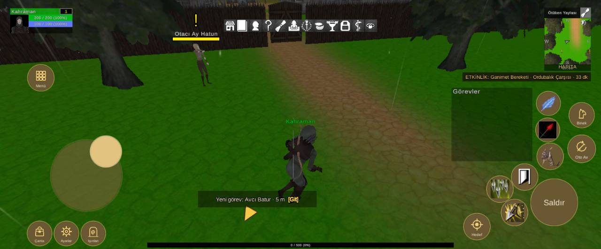

# Arayüz yerleşimi, 1600x664 ekran

Durum: 🔴 açık

| Tekrar | Cihaz | Sürümler | İlk görülme | Son görülme |
|---|---|---|---|---|
| 1 | 1 | 1.0.79 | 16.10.2026 02:12 | 16.10.2026 02:12 |


## İlk rapor

**Arayüz** · sürüm **1.0.79** · samsung SM-A075F · Android OS 16 / API-36 (BP2A.250605.031.A3/A075FXXS3BZA1) · ekran 1600x664 · FeaturesDemoZone

### Mesaj
```text
2 çakışma (1600x664)
```

### Ayrıntı
```text
Ekran 1600x664, güvenli alan (64,0 1536x664)
Beceri2 kaydırıldı (-10, -40)
Beceri3 kaydırıldı (-40, -20)
Beceri4 kaydırıldı (20, -20)
Beceri5 kaydırıldı (20, 0)
Beceri6 kaydırıldı (110, 120)
Çakışmalar (2):
- düğme Beceri7 ~ QuestTrackerWindow (QuestTrackerWindow/Contents/QuestTrackerPanel)
- düğme Beceri3 ~ düğme Beceri8
Düğmeler:
Hareket (135,100 191x191)
Çanta (73,9 65x65)
Ayarlar (145,9 65x65)
Işınlan (216,9 65x65)
Menü (74,422 70x70)
Saldır (1413,62 124x124)
Beceri1 (1430,212 70x70)
Beceri2 (1362,157 70x70)
Beceri3 (1296,125 70x70)
Beceri4 (1335,62 70x70)
Beceri5 (1427,286 63x63)
Beceri6 (1429,357 63x63)
Beceri7 (1282,202 63x63)
Beceri8 (1252,130 63x63)
Oto Av (1512,231 73x73)
Binek (1515,324 66x66)
Hedef (1235,25 70x70)
Göstergeler:
MiniMap (1449,475 124x169)
PlayerUnitFrame (27,575 166x66)
QuestTrackerWindow (1202,234 216x195)
SystemBar (596,579 408x33)
XPBarPanel (392,4 817x12)
```

<details><summary>Ortam</summary>

```text
tur: arayuz
surum: 1.0.79
cihaz: samsung SM-A075F
sistem: Android OS 16 / API-36 (BP2A.250605.031.A3/A075FXXS3BZA1)
grafik: Vulkan / Mali-G57 MC2 / bellek 3614 MB
ekran: 1600x664
ayarlar: kalite -1, çözünürlük 2, gölge 0, fps sınırı 0
sahne: FeaturesDemoZone
oyuncu: seviye 1
sure: 53 sn
```

</details>

<details><summary>Oyunun durumu</summary>

```text
Sürüm 1.0.79 | samsung SM-A075F | Android OS 16 / API-36 (BP2A.250605.031.A3/A075FXXS3BZA1)
Vulkan Mali-G57 MC2 | Bellek 3614 MB | 1600x664 | FPS 25 | Süre 51 sn
Kare süresi: işlemci 42.8 ms | ekran kartı 0.0 ms | ekran 60 Hz | hedef 30 | kalite Very Low | çizim 1280x531 (ekran 1600x664, ölçek 0.80) | pil 85%
Sahneler: FeaturesDemoZone
Giriş: dokunmatik var | fare yok | ekran tuşları açık
Son dokunuş: 235,176 -> MobileHudCanvas/MoveStick [MobileHudCanvas 5]
Oyuncu karakteri: oluştu (MecanimMale1) | Önizleme karakteri: yok | Önizleme kamerası: kapalı
```

</details>

<details><summary>Son kayıt satırları</summary>

```text
02:12:42 [Warning] [Reklam] onay bilgisi: Publisher misconfiguration: Failed to read publisher's account configuration; no form(s) configured for the input app ID. Verify that you have configured one or more forms for t...
```

</details>


## Ekran görüntüleri



## Görülmeler (yeniden eskiye)

| Zaman · sürüm · cihaz · harita · oyuncu · ekran |
|---|
| 16.10.2026 02:12 · 1.0.79 · samsung SM-A075F · FeaturesDemoZone · seviye 1 · 1600x664 |

Anahtar: `arayuz-1600x664`
