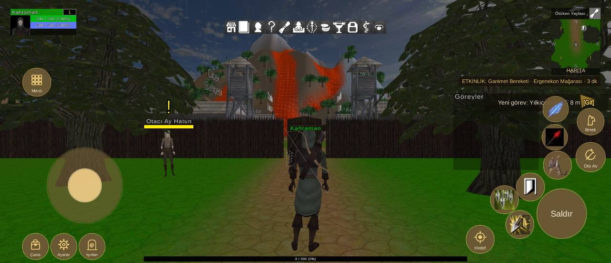

# Arayüz yerleşimi, 2340x1007 ekran

Durum: 🔴 açık

| Tekrar | Cihaz | Sürümler | İlk görülme | Son görülme |
|---|---|---|---|---|
| 1 | 1 | 1.0.79 | 10.10.2026 20:42 | 10.10.2026 20:42 |


## İlk rapor

**Arayüz** · sürüm **1.0.79** · samsung SM-A346E · Android OS 15 / API-35 (AP3A.240905.015.A2/A346EXXU9DYF4) · ekran 2340x1007 · FeaturesDemoZone

### Mesaj
```text
2 çakışma (2340x1007)
```

### Ayrıntı
```text
Ekran 2340x1007, güvenli alan (73,0 2267x1007)
Beceri2 kaydırıldı (-10, -40)
Beceri3 kaydırıldı (-40, -20)
Beceri4 kaydırıldı (20, -20)
Beceri5 kaydırıldı (20, 0)
Beceri6 kaydırıldı (110, 120)
Çakışmalar (2):
- düğme Beceri7 ~ QuestTrackerWindow (QuestTrackerWindow/Contents/QuestTrackerPanel)
- düğme Beceri3 ~ düğme Beceri8
Düğmeler:
Hareket (180,152 290x290)
Çanta (87,14 98x98)
Ayarlar (195,14 98x98)
Işınlan (303,14 98x98)
Menü (88,639 106x106)
Saldır (2057,94 189x189)
Beceri1 (2082,322 106x106)
Beceri2 (1979,238 106x106)
Beceri3 (1879,190 106x106)
Beceri4 (1938,95 106x106)
Beceri5 (2077,434 96x96)
Beceri6 (2080,541 96x96)
Beceri7 (1857,307 96x96)
Beceri8 (1812,198 96x96)
Oto Av (2207,350 111x111)
Binek (2212,491 101x101)
Hedef (1786,38 106x106)
Göstergeler:
MiniMap (2111,720 189x257)
PlayerUnitFrame (40,872 252x101)
QuestTrackerWindow (1736,356 327x296)
SystemBar (861,877 618x50)
XPBarPanel (551,6 1239x19)
```

<details><summary>Ortam</summary>

```text
tur: arayuz
surum: 1.0.79
cihaz: samsung SM-A346E
sistem: Android OS 15 / API-35 (AP3A.240905.015.A2/A346EXXU9DYF4)
grafik: Vulkan / Mali-G68 MC4 / bellek 7471 MB
ekran: 2340x1007
ayarlar: kalite 1, çözünürlük 0, gölge 0, fps sınırı 1
sahne: FeaturesDemoZone
oyuncu: seviye 1
sure: 145 sn
```

</details>

<details><summary>Oyunun durumu</summary>

```text
Sürüm 1.0.79 | samsung SM-A346E | Android OS 15 / API-35 (AP3A.240905.015.A2/A346EXXU9DYF4)
Vulkan Mali-G68 MC4 | Bellek 7471 MB | 2340x1007 | FPS 36 | Süre 142 sn
Kare süresi: işlemci 30.4 ms | ekran kartı 26.1 ms | ekran 120 Hz | hedef 60 | kalite Medium | çizim 1755x755 (ekran 2340x1007, ölçek 0.75) | pil 100%
Sahneler: FeaturesDemoZone
Giriş: dokunmatik var | fare bağlı | ekran tuşları açık
Son dokunuş: 1381,138 -> CloseButton/Text [SystemMenuUICanvas 19]
Oyuncu karakteri: oluştu (MecanimMale2) | Önizleme karakteri: yok | Önizleme kamerası: kapalı
```

</details>

<details><summary>Son kayıt satırları</summary>

```text
20:41:48 [Warning] [Reklam] onay bilgisi: Publisher misconfiguration: Failed to read publisher's account configuration; no form(s) configured for the input app ID. Verify that you have configured one or more forms for t...
```

</details>


## Ekran görüntüleri



## Görülmeler (yeniden eskiye)

| Zaman · sürüm · cihaz · harita · oyuncu · ekran |
|---|
| 10.10.2026 20:42 · 1.0.79 · samsung SM-A346E · FeaturesDemoZone · seviye 1 · 2340x1007 |

Anahtar: `arayuz-2340x1007`
