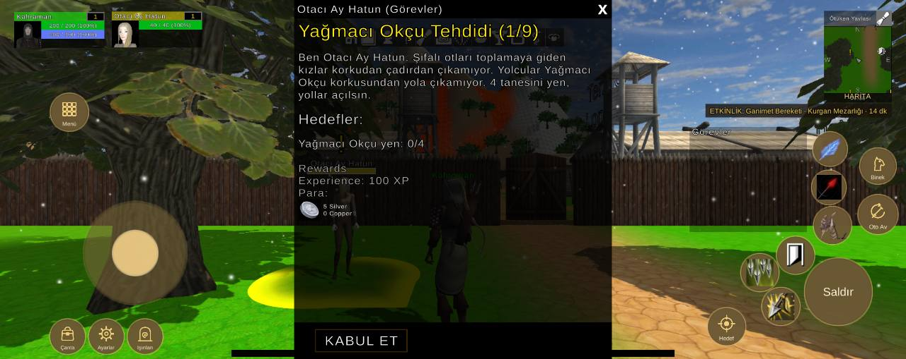

# Arayüz yerleşimi, 2412x960 ekran

Durum: 🔴 açık

| Tekrar | Cihaz | Sürümler | İlk görülme | Son görülme |
|---|---|---|---|---|
| 1 | 1 | 1.0.79 | 11.10.2026 02:31 | 11.10.2026 02:31 |


## İlk rapor

**Arayüz** · sürüm **1.0.79** · OnePlus CPH2447 · Android OS 16 / API-36 (TP1A.220905.001/T.R4T3.457a297-20cee51-20cee58) · ekran 2412x960 · FeaturesDemoZone

### Mesaj
```text
2 çakışma (2412x960)
```

### Ayrıntı
```text
Ekran 2412x960, güvenli alan (120,0 2292x960)
Beceri2 kaydırıldı (-10, -40)
Beceri3 kaydırıldı (-40, -20)
Beceri4 kaydırıldı (20, -20)
Beceri5 kaydırıldı (20, 0)
Beceri6 kaydırıldı (110, 120)
Çakışmalar (2):
- düğme Beceri7 ~ QuestTrackerWindow (QuestTrackerWindow/Contents/QuestTrackerPanel)
- düğme Beceri3 ~ düğme Beceri8
Düğmeler:
Hareket (222,145 276x276)
Çanta (133,13 94x94)
Ayarlar (236,13 94x94)
Işınlan (340,13 94x94)
Menü (134,610 101x101)
Saldır (2142,90 180x180)
Beceri1 (2166,307 101x101)
Beceri2 (2068,227 101x101)
Beceri3 (1973,181 101x101)
Beceri4 (2029,90 101x101)
Beceri5 (2161,413 91x91)
Beceri6 (2164,516 91x91)
Beceri7 (1952,293 91x91)
Beceri8 (1908,188 91x91)
Oto Av (2285,334 106x106)
Binek (2290,468 96x96)
Hedef (1884,36 101x101)
Göstergeler:
FocusUnitFrame (298,833 240x96)
MiniMap (2194,686 180x245)
PlayerUnitFrame (38,832 240x96)
QuestTrackerWindow (1836,339 312x282)
SystemBar (911,836 589x48)
XPBarPanel (616,6 1181x18)
```

<details><summary>Ortam</summary>

```text
tur: arayuz
surum: 1.0.79
cihaz: OnePlus CPH2447
sistem: Android OS 16 / API-36 (TP1A.220905.001/T.R4T3.457a297-20cee51-20cee58)
grafik: Vulkan / Adreno (TM) 740 / bellek 15134 MB
ekran: 2412x960
ayarlar: kalite 1, çözünürlük 0, gölge 0, fps sınırı 1
sahne: FeaturesDemoZone
oyuncu: seviye 1
sure: 83 sn
```

</details>

<details><summary>Oyunun durumu</summary>

```text
Sürüm 1.0.79 | OnePlus CPH2447 | Android OS 16 / API-36 (TP1A.220905.001/T.R4T3.457a297-20cee51-20cee58)
Vulkan Adreno (TM) 740 | Bellek 15134 MB | 2412x960 | FPS 59 | Süre 80 sn
Kare süresi: işlemci 17.9 ms | ekran kartı 9.8 ms | ekran 60 Hz | hedef 60 | kalite Medium | çizim 1809x720 (ekran 2412x960, ölçek 0.75) | pil 34%
Sahneler: FeaturesDemoZone
Giriş: dokunmatik var | fare yok | ekran tuşları açık
Son dokunuş: 695,438 -> oyun dünyası
Oyuncu karakteri: oluştu (MecanimMale1) | Önizleme karakteri: yok | Önizleme kamerası: kapalı
```

</details>

<details><summary>Son kayıt satırları</summary>

```text
02:31:23 [Warning] [Reklam] onay bilgisi: Publisher misconfiguration: Failed to read publisher's account configuration; no form(s) configured for the input app ID. Verify that you have configured one or more forms for t...
```

</details>


## Ekran görüntüleri



## Görülmeler (yeniden eskiye)

| Zaman · sürüm · cihaz · harita · oyuncu · ekran |
|---|
| 11.10.2026 02:31 · 1.0.79 · OnePlus CPH2447 · FeaturesDemoZone · seviye 1 · 2412x960 |

Anahtar: `arayuz-2412x960`
